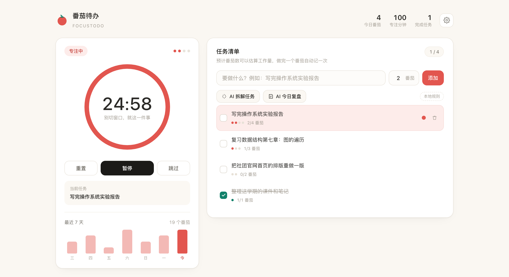
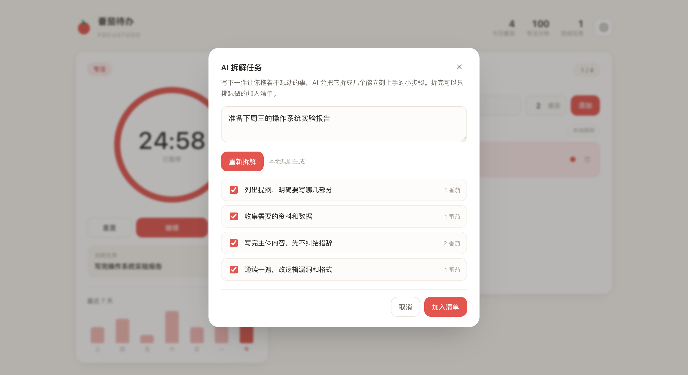
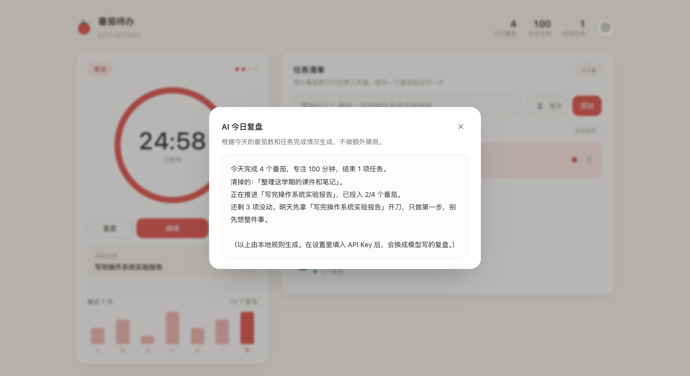
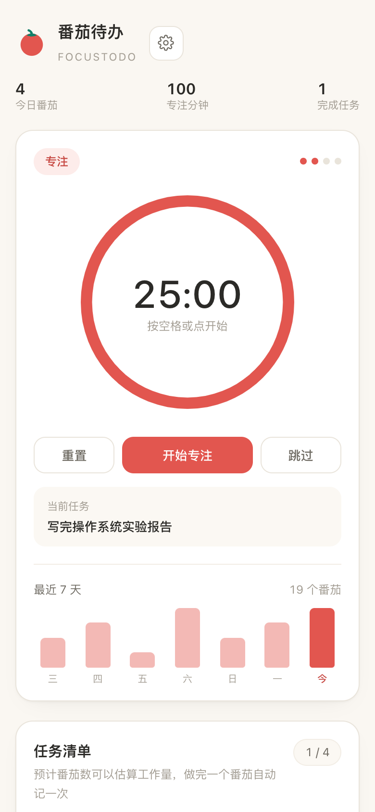

# 番茄待办 · FocusTodo

一个把**番茄钟**和**任务清单**焊在一起的小工具：计时不是孤立的，每跑完一个番茄会记到当前任务头上，读完之后还能让 AI 帮你把拖着不动的任务拆成能立刻上手的小步骤。

纯原生 HTML / CSS / JavaScript，零依赖、无构建步骤，下载下来双击就能用。



---

## 一、想做什么

我原来的需求很朴素：**我不是不知道要做什么，我是坐不下来。**

市面上的番茄钟和待办清单是两个割裂的东西——番茄钟只管 25 分钟倒计时，不管你在做什么；待办清单只管列事情，不管你有没有开始。于是出现两个典型场景：

- 番茄钟响了 25 分钟，但你其实在刷手机，它照样给你记一个「完成」；
- 清单列了十条，第一条太吓人，于是一条都没动。

所以我想做的是一个**把「专注」和「具体一件事」绑在一起**的工具：

1. 每个番茄必须挂在某个任务上，番茄数就是这件事的投入成本；
2. 任务开始前如果觉得太大、不知道从哪下手，让 AI 拆成 3～5 个能立刻动手的步骤；
3. 一天结束时，根据真实数据给一段复盘，而不是让我凭感觉评判自己。

目标不是做一个功能齐全的效率软件，而是做一个**我自己明天还愿意打开**的小工具。

## 二、做了什么

### 1. 番茄钟

- 25 分钟专注 / 5 分钟短休 / 每 4 个番茄一次 15 分钟长休，时长和间隔都可以在设置里改；
- 暂停、继续、重置、跳过；跳过专注**不计入统计**，避免自己骗自己；
- 阶段结束有三声提示音 + 标题栏闪烁提醒，切到别的标签页也能看到倒计时（`24:58 · 专注中`）；
- 圆环进度、本轮番茄圆点、当前绑定任务一目了然。

### 2. 任务清单

- 添加任务时可以填「预计几个番茄」，相当于给这件事估个工作量；
- 点任务行 = 绑定为当前任务，跑完的番茄会累加到它的进度上（`2/4 番茄`）；
- 勾选完成、双击重命名、删除（删任务不删历史专注记录）；
- 完成的自动沉到底部并置灰，未完成的按时间倒序。

### 3. 统计

- 顶栏三个数字：今日番茄数、今日专注分钟、今日完成任务数；
- 最近 7 天柱状图，今天用实心色标出来。

### 4. AI 能力（双通道）

这是这个项目里唯一「有点意思」的部分，也是设计上花了最多心思的地方。

**通道 A：本地规则（默认，不需要任何 Key）**
用关键词把任务归类到「写作 / 备考 / 编码 / 学习 / 整理 / 事务」，套对应的拆解模板；复盘也是根据真实数据填模板。好处是**离线、免费、永远不会挂**，缺点是套路化，遇到奇怪的任务只能走通用模板。

**通道 B：远程模型（填了 Key 自动启用）**
走 OpenAI 兼容的 `/chat/completions` 接口，用结构化的 prompt 让模型输出 JSON 数组。填了 Key 之后，右上角标签会从「本地规则」变成「AI 在线」。

关键点是**降级策略**：远程调用失败（网络、超时、额度、返回格式不对）时，自动回落到本地规则并把原因显示在界面上，不会让功能直接不可用。

| AI 拆解任务 | AI 今日复盘 |
| --- | --- |
|  |  |

### 5. 其他

- 数据全部存在浏览器 `localStorage`，没有后端、没有账号；
- 支持导出 / 导入 JSON 备份；
- 响应式，手机上也是单列布局。



## 三、怎么跑起来

```bash
git clone <你的仓库地址>
cd pomodoro-todo
```

然后二选一：

**方式一：直接打开（最快）**

双击 `index.html`。Chrome / Edge 下可以直接用；Safari 对 `file://` 的 localStorage 限制比较严，建议用方式二。

**方式二：起一个本地服务器（推荐）**

```bash
python3 -m http.server 8000
# 打开 http://localhost:8000
```

### 配置 AI（可选）

点右上角齿轮 → 「AI 接口」：

| 字段 | 说明 |
| --- | --- |
| Base URL | 任意 OpenAI 兼容端点，例如 `https://api.openai.com/v1`、`https://api.deepseek.com/v1` |
| 模型 | 例如 `gpt-4o-mini`、`deepseek-chat` |
| API Key | 只写进你本机的 localStorage，不写进代码 |

**Key 不填也完全能用**，所有 AI 功能会走本地规则。

## 四、目录结构

```
pomodoro-todo/
├── index.html              页面结构
├── css/
│   └── style.css           全部样式（含响应式）
├── js/
│   ├── store.js            数据层：localStorage 读写、任务与专注记录、发布订阅
│   ├── timer.js            番茄钟状态机（时间戳驱动，不怕后台节流）
│   ├── tasks.js            任务列表渲染与交互
│   ├── ai.js               AI 双通道：本地规则 + OpenAI 兼容接口
│   ├── stats.js            顶栏数字与七日柱状图
│   └── app.js              启动装配、弹层、快捷键、提示音
├── docs/screenshots/       README 用截图
└── .gitignore
```

## 五、遇到的问题，以及怎么解决的

**1. 弹层「隐藏」了，却还在挡住整屏的点击**

给弹层容器加了 `hidden` 属性，但它同时有 `display: flex` 的类样式。`[hidden]` 自带的 `display: none` 来自浏览器默认样式表，优先级比类选择器低，于是被 `display: flex` 盖掉了——弹层看起来是「透明」的，实际上一直铺在页面上吃掉所有点击，表现是「按钮点了没反应」。

解决：显式加一条 `[hidden] { display: none !important; }`。这个问题是用自动化截图脚本点不到元素才暴露出来的，肉眼看截图完全看不出来。

**2. 切到后台，倒计时会变慢**

最初用 `setInterval` 每秒把剩余秒数减一，但浏览器会节流后台标签页的定时器（可能降到 1 秒一次甚至更慢），跑一趟 25 分钟能差出好几分钟。

解决：改成**记录结束时间戳** `endAt = Date.now() + remainMs`，每次 tick 只用 `Date.now()` 反推剩余量，定时器频率只影响界面刷新，不影响计时准确性；再监听 `visibilitychange`，切回前台时补算一次。

**3. 晚上 8 点以后记录的番茄，被算到了「明天」**

一开始用 `toISOString().slice(0, 10)` 取日期，那是 **UTC** 时间，东八区会往前错 8 小时，导致晚上 8 点后的数据跨天。

解决：自己写 `dayKey()`，用 `getFullYear / getMonth / getDate` 按本地时区拼 `YYYY-MM-DD`，并统一在所有统计里使用。

**4. 模型返回的 JSON 并不干净**

直接 `JSON.parse` 经常报错：模型会把数组包在 ` ```json ` 代码块里，或者在前后加一句「好的，这是结果」。

解决：三层兜底——先去掉 markdown 代码围栏 → 尝试 `JSON.parse` → 失败就用正则抓第一个 `[...]` 再解析 → 还失败就整个回落到本地规则。界面上会提示「模型调用失败，已用本地规则：原因」，不静默失败。

**5. 任务重命名时，一次回车提交了两次**

`Enter` 提交后立刻重渲染，输入框被移除触发 `focusout`，结果又提交了一次（于是两次重绘、偶发光标乱跳）。

解决：`focusout` 里延迟 80ms，并检查该输入框是否还在文档中（`document.body.contains`）——重渲染后它已经脱离文档，直接跳过。

**6. 公开仓库里的 API Key 问题**

这个仓库是公开的，Key 绝不能进 git。做法是：

- Key 存在**独立的** localStorage 条目（`focustodo.apikey.v1`），不放在主数据结构里；
- 导出 JSON 只导出主数据，天然不含 Key；
- 代码里没有任何硬编码 Key、没有 `.env` 依赖；
- `.gitignore` 里预先挡掉了 `.env`、`*.key`、`secrets.json` 等。

## 六、已知不足

- 没有跨设备同步，换浏览器数据就没了（导出/导入 JSON 只能手动搬）；
- 专注记录只按天聚合，没有「每天几点最容易专注」这类分析；
- AI 拆解的质量取决于 prompt，本地规则的分类维度还比较粗（只按动词/名词关键词）；
- 任务不能拖动排序，也不能设截止时间。

## 七、下一步想加的

1. 任务拖动排序 + 优先级；
2. 自定义「专注-休息」节奏（比如 50/10 的深度工作模式）；
3. 把每周数据导出成 Markdown 周报；
4. 用 Service Worker 加离线缓存，做成可安装的 PWA。

---

项目用 WorkBuddy（AI Agent）辅助完成，代码结构、调试与文档均在本地完成。欢迎提 issue。
